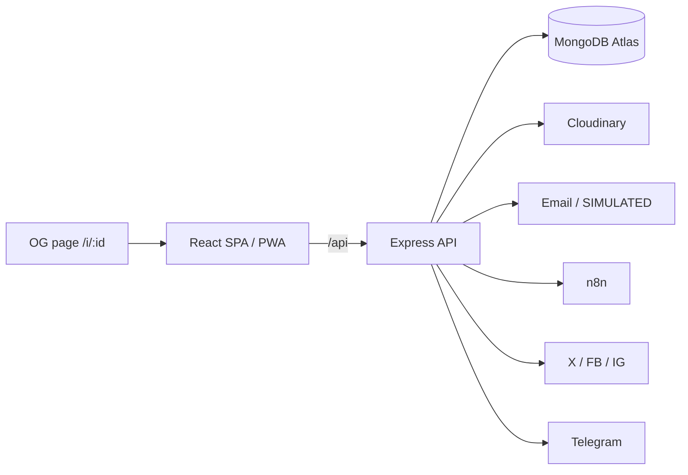
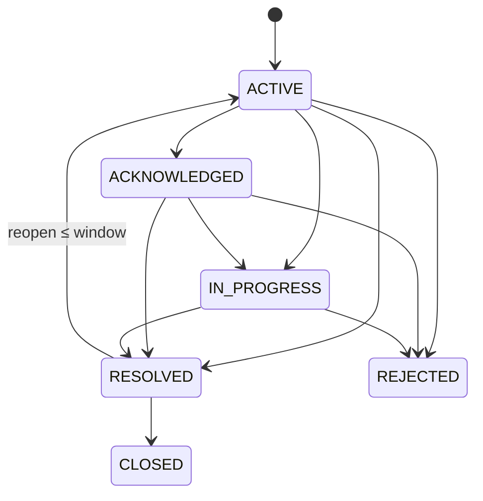
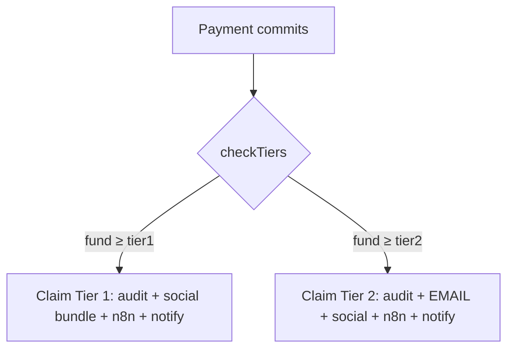

# Samadhan — civic problems, solved together

A bilingual (English / हिंदी), mobile-first civic utility prototype. **Two modes:**

- **Global** — report public civic problems with a simulated ₹5 fee; neighbours
  add +1 support (₹1). Pooled funds unlock **official, tracked amplification**:
  Tier 1 (Spotlight) drafts a facts-only social bundle; Tier 2 (Escalation) sends
  a formal email to the matched government department.
- **Local** — a free directory of admin-verified helpers (plumber, electrician,
  cab, cleaning, locksmith, carpenter, painter, packers, grocery). Phone numbers
  stay hidden until you Connect; only connected users can review.

> **Mandatory disclaimers:** Samadhan is **not an official government portal**.
> All money is **simulated** (integer paise, no real payments). In an emergency
> always call **112**. Public posts are **facts-only** — no personal attacks,
> no reporter PII, no individual officer names.

## Tech stack
React 18 + Vite + Tailwind + shadcn-style UI + react-i18next + Leaflet/OSM +
Recharts + vite-plugin-pwa · Node + Express 5 + Mongoose 9 + Zod · MongoDB Atlas
(2dsphere + transactions) · Cloudinary · Nodemailer · node-cron · Vitest.

## Architecture




## Prerequisites
Node ≥ 20.19, npm, a MongoDB Atlas connection string (or run without persistence).

## Setup from scratch
```bash
# server
cd server && cp .env.example .env   # fill MONGO_URI, JWT_SECRET
npm install
npm run seed:admin && npm run seed:authorities && npm run seed:helpers
npm run seed:demo                    # rich demo data (optional)
npm run dev                          # http://localhost:5000

# client (new terminal)
cd client && cp .env.example .env    # VITE_API_URL
npm install && npm run dev           # http://localhost:5173
```

## Scripts
| Where | Script | Purpose |
| --- | --- | --- |
| server | dev / start | run API |
| server | test | Vitest suite (142 tests) |
| server | seed:admin / seed:authorities / seed:helpers / seed:demo | seeds |
| server | demo:reset / demo:on / demo:off | demo data + tier mode |
| server | verify:data | data-integrity verifier |
| server | verify | tests + env-example check + secret scan |
| server | check:env / check:secrets | env-example parity / secret scan |
| server | job:autoclose | manual auto-close pass |
| client | dev / build / preview | run / build / preview |
| client | test | client unit tests (18) |
| client | i18n:audit | EN/HI parity + usage audit |
| client | lint:a11y | accessibility lint |
| client | check-sw | service-worker safety check |
| client | pwa:assets | generate PWA icons |

## Folder structure
`server/src/modules/{users,wallet,issues,tiers,dispatch,social,authorities,helpers,notifications,admin,internal,health,uploads}` ·
`server/src/{jobs,seed,scripts,middleware,utils,config}` ·
`client/src/{features/{global,local,wallet,maps,notifications,admin},pages,components,lib,i18n}`.

## Testing strategy
Server: Vitest + Supertest + mongodb-memory-server (replica set for real
transactions) — unit, concurrency invariants, RBAC matrices, e2e journey,
data-integrity verifier with corrupted fixtures. Client: Vitest pure-utility
tests + i18n audit + a11y lint + SW check. No real external calls in tests.

## Security
JWT + role + ownership on protected routes; admin strictly ADMIN; integer paise;
atomic idempotent payments; phones hidden until Connect; PII-free audit/social/
notification payloads; contact guard on free text; production env validation;
secret scan; CORS exact origins; helmet; rate limiting.

## Deployment
See [docs/DEPLOYMENT.md](docs/DEPLOYMENT.md) (Render + Vercel + Atlas + cron-job.org).

## Honest limitations
Single-instance in-memory connect lock + rate limiter; OSM/Nominatim usage is
prototype-only; polling not push; helper coordinates approximated publicly;
seeds are sample data. Not production-hardened for horizontal scale.

## Screenshots
Optional — add real captures under `docs/screenshots/` after running the demo (`npm run demo:reset`):
`landing.png`, `report-wizard.png`, `issue-detail.png`, `map.png`, `local-search.png`,
`helper-profile.png`, `admin-dashboard.png`, `notifications-hi.png`, `pwa-install.png`.

## Phase history
0 foundation · 1 auth · 2 wallet · 3 report/feed · 4 support/duplicates ·
5 tiers/dispatch · 6 social/OG/trending · 7 local helpers (+7.1 hardening) ·
8 maps/notifications/admin · 9 polish/PWA/offline + production hardening/demo/verifier.
