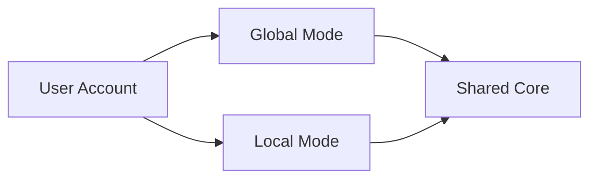

# CHAPTER 1

## INTRODUCTION

### 1.1 Background and Motivation

Residents in Indian cities walk past potholes, broken streetlights, blocked drains, and uncollected garbage almost daily. Municipal portals usually hand out a complaint number without showing what neighbours already filed. Because nobody sees an existing post, twenty people on the same street end up submitting separate tickets for one junction [1]. City staff waste hours sorting duplicates. Citizens stop checking when updates stall [7], even though public reporting helps clear multi-department faults faster when replies stay visible [2].

Household repair help has a different set of problems. When a tap leaks or a switch burns out, families ask neighbours or use commercial apps that take steep commissions. Many large service apps track workers over live GPS and leave phone numbers open to automated scraping [9]. Neighbours who live a few streets apart usually want a simpler directory with checked profiles and honest reviews [8].

We built Samadhan v2 during our summer internship to put both tools in one English and Hindi web app. A user switches between Global Mode for civic complaints and Local Mode for nearby helpers from the same login. Both modes share the same accounts, MongoDB database, and admin dashboard.

Our backend runs on Node.js, Express 5, Mongoose, and MongoDB Atlas with location indexes and transactions. The frontend uses React 18, Tailwind CSS, Leaflet with OpenStreetMap maps, and offline draft saving.

*Figure 1.1: Dual-mode design of Samadhan v2 combining Global civic reporting and Local helper discovery.*

### 1.2 Problem Statement

Civic complaint portals break down easily. Bots can flood free forms with spam [10]. Without a distance check, twenty complaints about one dark streetlight sit as twenty separate database records. Raw ticket counts can also skew city priorities because wealthier areas submit far more online tickets than low-income wards [5].

Local repair directories face a different problem. Showing a worker's home address and mobile number to every visitor invites unwanted calls. Allowing any account to post ratings also makes fake five-star scores easy to buy [8].

We put these rules in the backend code itself, not just in frontend forms. Wallet balances and issue funds store integer paise, such as `500` for 5 rupees and `100` for 1 rupee. Whole numbers avoid decimal rounding bugs when refunds split across many users. Each issue also tracks its repair status (`ACTIVE` to `CLOSED` or `REJECTED`) separately from its escalation tier (`0`, `1`, or `2`), so admin status edits never wipe out crowd support tiers.

### 1.3 Objectives

During this internship, we targeted five practical goals inside the Samadhan v2 codebase:

1. Duplicate checking for civic issues. Before charging the simulated 5-rupee fee, the backend looks for an open issue of the same category within 100 meters over the last 30 days. If a match turns up, it returns HTTP 409 so the user can add 1 rupee of support (`+1`) to that ticket.
2. Transaction-safe wallet balances and full refunds. Balance checks, deductions, ledger entries, and support rows run inside one MongoDB transaction. When an admin marks an issue `REJECTED`, the backend refunds each user's exact paise amount and resets the fund to zero.
3. Post-commit escalation with safe fallbacks. After a payment commits, a separate check tests whether the issue reached 200 rupees (Tier 1) or 500 rupees (Tier 2), or 20 and 50 rupees in demo mode. One atomic update picks a single winner to generate six bilingual social post templates and an authority email preview, saving `SIMULATED` rows if external keys are empty.
4. Privacy-first local helper directory. Local Mode covers nine household trades for free and leaves out medical help so emergencies go straight to India's 112 helpline. Search checks both the user's radius and the helper's own service radius, then rounds public coordinates to three decimal places (about 110 meters). Phone numbers unlock only on a Connect tap (max 10 per 24 hours), reviews require a prior connection, and text filters block phone numbers and links.
5. Bilingual screens and offline draft recovery. English and Hindi files match across 817 translation keys, while the report form saves text drafts in `localStorage` for 7 days and excludes API routes from the offline cache.

### 1.4 Scope and Prototype Limits

Samadhan v2 is an academic B.Tech prototype, not a live municipal system. Banners across the wallet, report, and local screens state that rupee balances are demo units without real UPI or bank transfers. Emails and social media posts go live only if an operator configures SMTP or social tokens. Otherwise, the server saves `SIMULATED` rows for review in the admin dashboard.

Medical help stays out of scope, so Local Mode shows a 112 emergency banner for urgent cases. Our per-user connect locks and IP rate limits live inside Node server memory, not Redis. That single-server design keeps local setup simple. Running multiple servers later would need a shared store. Table 1.1 lists what is built today and what belongs to future production work.

*Table 1.1: Implemented prototype features compared with deferred production items.*

| Area | Built in Samadhan v2 | Left for Future Production |
| :--- | :--- | :--- |
| Wallet & Money | Demo wallet in integer paise, top-up packs (Rs 10 to 100), atomic ledger rows, full refunds on spam rejection | Real Razorpay or UPI payment gateway integration and bank payouts |
| Maps & Location | MongoDB 2dsphere nearby duplicate check (100 m), map bounding-box queries, Leaflet marker clusters | Self-hosted map tile server and paid geocoding API without 1-second throttling |
| Escalation & Posts | Six-platform bilingual post templates (optional external drafting key), Nodemailer email previews, simulated fallback logs | Two-way integration with live city CRM or CPGRAMS grievance portals |
| Helper Trust | Admin approval queue (`PENDING` to `VERIFIED`), re-verify on key profile edits, 10/24h Connect limit, 3-flag auto-hide | Automated SMS OTP verification for helper phone numbers |
| Notifications & Scale | 30-second unread notification polling, in-memory rate limits and connect locks, 7-day offline form drafts | Background Web Push alerts, live WebSockets, and Redis shared locks |

Next, Chapter 2 reviews ten related research papers on civic reporting and local worker platforms. Chapters 3 and 4 cover the architecture, database design, test results, and bugs fixed, and Chapter 5 gives our conclusions and next steps.
