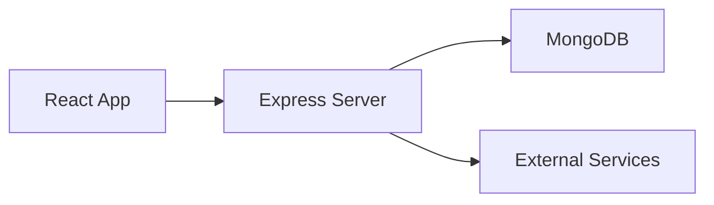
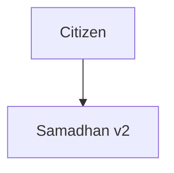
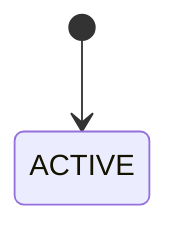

# CHAPTER 3

## METHODOLOGY

### 3.1 System Structure and Modules

We split the Express 5 backend into 13 feature folders under `server/src/modules/`: `admin`, `authorities`, `dispatch`, `health`, `helpers`, `internal`, `issues`, `notifications`, `social`, `tiers`, `uploads`, `users`, and `wallet`. Each folder separates routes, Zod validation schemas, controllers, services, and Mongoose models.

Requests enter `server/src/app.js`, pass through `helmet` headers, origin checks locked to `CLIENT_URL`, and a 100 KB JSON limit. Controllers read validated inputs and return standard JSON responses, while services handle all database queries and transactions. Putting business rules inside services also let our tests and cron tasks call functions like `chargeWallet()` and `transitionIssue()` directly. Two `node-cron` jobs run in the background: an hourly task closes expired resolved issues after 7 days, and a 10-minute sweep retries pending emails. Sleeping hosts can trigger `/api/internal/jobs/:job` via a secret header checked with constant-time comparison.

External services sit behind fallback adapters. Photo uploads take JPEG, PNG, or WebP files up to 5 MB in memory and send them to Cloudinary. When Cloudinary keys are missing, uploads return HTTP 503 so users can skip photos and finish posting. Email dispatch and social post templates record `SIMULATED` rows whenever SMTP or social keys are empty. Built-in English and Hindi templates generate all six captions by default, with an optional external drafting key supported if set.

*Figure 3.1: Overall architecture of Samadhan v2 showing frontend PWA caching, modular backend services, database storage, and external fallbacks.*

Figure 3.2 gives the Level 0 context diagram and Level 1 data flows for civic reporting and local helper connections.

*Figure 3.2: Level 0 context diagram and Level 1 data flows for Global reporting and Local helper connections.*

### 3.2 Database Collections and Sample Data

All data lives across 17 MongoDB collections on an Atlas replica set, giving us multi-document transactions. Currency fields store integer paise (`100` paise = 1 rupee), and timestamps use UTC.

Database indexes enforce core rules under parallel traffic. Unique indexes on `(issueId, userId)` stop the same user from supporting an issue twice, while partial unique indexes on `idempotencyKey` and `dedupeKey` ignore `null` entries. Notifications expire after 90 days (`7,776,000` seconds) via a MongoDB TTL index. Because MongoDB forbids one compound index across two array fields, the `authorities` collection creates separate indexes on `cityKeys` and `categories`. Table 3.1 lists all 17 collections.

*Table 3.1: Summary of all 17 MongoDB collections and their indexes.*

| # | Collection | Main Stored Fields | Key Indexes |
| :---: | :--- | :--- | :--- |
| 1 | `users` | Name, email, hashed password, phone, role (`CITIZEN`/`HELPER`/`ADMIN`), language, home location, active mode, active flag | Unique `email`, `2dsphere(homeLocation)`, `role` |
| 2 | `wallets` | Owner `userId`, integer `balancePaise` (`>= 0`) | Unique `userId` |
| 3 | `wallettxns` | User, type (`TOPUP`, `REPORT_FEE`, `SUPPORT_FEE`, `REFUND`, `SIGNUP_CREDIT`), signed `amountPaise`, `issueId`, `idempotencyKey` | Unique `idempotencyKey`, `(userId, createdAt)`, `(type, createdAt)` |
| 4 | `settings` | Admin-editable config values (fees, tier thresholds, 100 m radius, 30-day window, 7-day auto-close, demo toggle) | Unique `key` |
| 5 | `issues` | Title, description, category (8 types), photos (max 3), location + address, reporter, status, tier (`0`/`1`/`2`), `fundPaise`, `platformCreditPaise`, `supporterCount`, `authorityId`, share clicks | `2dsphere(location)`, `(category, status, createdAt)`, `fundPaise`, text search, `reporterId` |
| 6 | `issuesupports` | Links `issueId` and `userId`, `amountPaise` paid, `isReporter` flag | Unique `(issueId, userId)` |
| 7 | `issueupdates` | Timeline entries (`STATUS`, `AUTHORITY_ASSIGNED`, `AUTHORITY_REPLY`, `PLATFORM_CREDIT`), `actorRole`, note, optional key | `(issueId, createdAt)`, partial unique `idempotencyKey` |
| 8 | `issueflags` | Issue, flagging user, reason (5 types), comment, dismissed flag | Unique `(issueId, userId)`, `(issueId, dismissed)` |
| 9 | `authorities` | Bilingual department names, categories, normalized `cityKeys`, email, social handles, active and fallback flags | Separate indexes on `cityKeys` and `categories` |
| 10 | `dispatchlogs` | Issue, tier, channel (`EMAIL`/`N8N_WEBHOOK`), status (`PENDING`, `SENT`, `SIMULATED`, `FAILED`, `SKIPPED`, `CANCELLED`), email preview, retry count | Unique `(issueId, tier, channel)`, `(issueId, sentAt)`, `(status, updatedAt)` |
| 11 | `socialposts` | Issue, tier, platform (6 apps), EN/HI captions, source tag, status, click count, takedown reason | `issueId`, `(issueId, tier)`, unique `(issueId, tier, platform)` |
| 12 | `auditlogs` | Append-only admin history (`action`, `entity`, `entityId`, `before`, `after`, actor role, fund snapshot) | `createdAt`, `(action, createdAt)`, `(entity, entityId, createdAt)` |
| 13 | `helpers` | User ref, display name, phone (private), 1–4 of 9 categories, experience, bio, price hint, service point, `radiusKm` (1–25), availability, verification status, rating average/count, connect count, flag count, hidden/sample flags | Unique `userId`, `2dsphere(serviceLocation)`, `(verificationStatus, isHidden, categories)` |
| 14 | `connections` | Seeker user ID, helper ID, creation timestamp (append-only) | `(seekerId, helperId)`, `(seekerId, createdAt)`, `(helperId, createdAt)` |
| 15 | `reviews` | Helper ID, seeker ID, integer rating (1–5), comment (max 500 chars) | Unique `(helperId, seekerId)` |
| 16 | `helperflags` | Helper ID, flagging user ID, reason, dismissed flag | Unique `(helperId, userId)` |
| 17 | `notifications` | User ID, 12 event types, small PII-free payload, optional `dedupeKey`, read time | `(userId, readAt, createdAt)`, partial unique `(userId, dedupeKey)`, 90-day TTL |

Seed scripts build sample data across Bengaluru, Mumbai, and Delhi using our real service functions. A production check blocks demo seeding unless `ALLOW_DEMO_SEED=true` is set. Table 3.2 lists the seeded datasets.

*Table 3.2: Sample datasets created by project seed scripts.*

| Script | Generated Records | Purpose in Demo & Testing |
| :--- | :--- | :--- |
| `admin.seed.js` | 1 admin account read from `.env` | Unlocks admin moderation, settings, and authority setup |
| `authorities.seed.js` | 6 sample offices (Bengaluru, Mumbai, Delhi, plus 1 wildcard fallback) | Tests 4-step department matching safely using `example.org` emails |
| `seedHelpers.js` | 32 sample helpers (30 verified: 15 Bengaluru, 8 Mumbai, 7 Delhi; plus 2 pending) | Tests distance sorting, radius filters, and approval queue |
| `seedDemo.js` | 12 reporters, 60 funded supporters, 36 issues (6 in Hindi), 2 credits, 2 replies, 3 flags, 15 connects, 10 reviews | Provides near-threshold issues (3 at Rs 19, 2 at Rs 49) and 30-day charts |

### 3.3 Main Rules and Step-by-Step Flows

MongoDB measures spherical distance in meters between a new report location and active issues of the same category:

$$\text{IsDuplicate}(P_{\text{new}}, c) \iff d_{\text{geo}}(P_{\text{new}}, e.\text{location}) \le R_{\text{dup}} \quad \text{and} \quad (t_{\text{now}} - e.\text{createdAt}) \le W_{\text{dup}} \tag{3.1}$$

Default settings set the search radius to 100 meters and the age window to 30 days, skipping `CLOSED` and `REJECTED` issues. Our code checks `idempotencyKey` before running Equation (3.1) so network retries never trip over a user's own new report.

Every issue keeps a strict paise balance checked by our verification script:

$$\text{Fund}(i) = \begin{cases} 0, & \text{if } i.\text{status} = \text{REJECTED} \\ \text{Sum of user contributions for } i + \text{Platform credit}(i), & \text{otherwise} \end{cases} \tag{3.2}$$

Admin platform credits raise the fund without touching any user wallet, and they do not refund when an issue is rejected [5]. User contributions always refund in full on rejection.

In Local Mode, helper search checks both the user's chosen distance (2, 5, or 10 km) and each helper's own service limit (1 to 25 km):

$$\text{ShowHelper}(h, P_{\text{user}}) \iff d_{\text{geo}}(P_{\text{user}}, h.\text{location}) \le \min(R_{\text{user}}, R_{\text{helper}}) \times 1000 \tag{3.3}$$

Only verified, non-hidden helpers pass Equation (3.3). Before returning JSON, the backend removes street addresses and rounds public coordinates to three decimal places (around 110 meters) [4, 6].

**Algorithm 3.1: Safe Wallet Update (`chargeWallet`)**

1. Verify that the transaction type is valid, the paise amount is a non-zero integer with the right sign, and an `idempotencyKey` was sent.
2. Query `WalletTxn` for that key. If found, return the existing result right away (`idempotent: true`) with zero extra charge.
3. Reuse the caller's MongoDB session if passed, or open a new transaction.
4. For credits, increment `balancePaise`. For deductions, run a conditional update requiring `balancePaise >= debit`; if nothing matches, abort and return HTTP 409 `INSUFFICIENT_BALANCE`.
5. Insert the ledger row. If parallel calls hit a duplicate-key collision, roll back and return the winning call's output.

**Algorithm 3.2: Issue Creation and Duplicate Gate (`createIssue`)**

1. Reject disabled categories loaded from `settings`.
2. Check if `idempotencyKey` already finished so mobile retries return the saved issue.
3. Unless `force = true` is set, run Equation (3.1) with `$geoNear`. If an open issue matches within 100 meters, return HTTP 409 `DUPLICATE_FOUND` with its summary and distance.
4. Start a transaction, read the report fee from `settings`, save the issue, debit the user via Algorithm 3.1, add the reporter's support row, and insert the `ACTIVE` timeline entry.
5. After commit, run `checkTiers()` inside a `try/catch` block so dispatch errors never undo a saved report.

**Algorithm 3.3: Post-Commit Tier Check and Department Matching (`checkTiers`)**

1. Read Tier 1 and Tier 2 targets from `settings` (20 and 50 rupees in demo mode, or 200 and 500 rupees normally).
2. Loop over tiers 1 and 2. Run one atomic `findOneAndUpdate` requiring `status != 'REJECTED'`, `fundPaise >= threshold`, and `tiersReached` not containing that tier.
3. Skip if the update returns `null` (another request won first). On a win, write an entry to `auditlogs`.
4. For Tier 1, normalize the city name first. Then pick the first active office matching exact city + category, exact city + `*`, fallback + category, or global fallback `*`.
5. Insert unique dispatch rows (`EMAIL` and optional webhook) and create the six bilingual social posts and notifications after commit.

*Figure 3.3: Issue lifecycle states enforced by `transitionIssue()`, kept separate from escalation tiers 0, 1, and 2.*

**Algorithm 3.4: Lifecycle Changes and Local Helper Rules (`transitionIssue` & `helper.service.js`)**

1. Open a transaction and check permissions against Figure 3.3. Admins set `ACKNOWLEDGED`, `IN_PROGRESS`, `REJECTED` (with at least a 10-character note), or `CLOSED`. Reporters mark tickets `RESOLVED` or reopen them within 7 days, while the hourly cron job only closes expired `RESOLVED` tickets.
2. When moving to `REJECTED`, load all `IssueSupport` rows, refund every contributor's exact paise via `chargeWallet()`, zero `fundPaise`, cancel open dispatches, and mark `SocialPost` entries `TAKEN_DOWN`.
3. Update the issue conditionally on its old status so parallel requests cannot collide, add an `IssueUpdate` row, commit, and notify users.
4. In Local Mode (`helper.service.js`), text checks strip invisible characters and convert regional numerals (such as Devanagari digits) to ASCII before blocking phone numbers or URLs. Editing `phone`, `categories`, `serviceLocation`, or `displayName` on a verified helper resets status to `PENDING`, while availability and bio edits do not.
5. Connect calls serialize per seeker using an in-memory lock. Repeat taps within 24 hours reveal the phone free of quota. New pairs save a connection, abort with HTTP 429 if the 10-per-24-hour cap is exceeded, and count once per unique user. Reviews require a prior connection and recompute averages with `$avg`, while three distinct non-dismissed flags auto-hide a helper.

### 3.4 API Routes, Security, and Bilingual Offline Support

All endpoints return `{ success: true, data }` or `{ success: false, error: { code, message } }`. Access tokens expire in 7 days and refresh tokens in 30 days, and `authenticate` verifies both role and `isActive: true` on protected routes. External API keys are swapped for `[REDACTED]` in error logs, and admin edits write whitelisted `AuditLog` entries without passwords or phone numbers. Table 3.3 lists the route namespaces in `server/src/app.js`.

*Table 3.3: Backend API route namespaces, access guards, and rate limits.*

| Path Prefix | Who Can Access | Rate Limits & Key Checks |
| :--- | :--- | :--- |
| `/api/health` | Public (`GET`) | Reports server uptime, MongoDB connection status, and git commit |
| `/api/auth` | Public (`register`, `login`, `refresh`); Logged-in users (`me`, `profile`, `change-password`, `switch-mode`) | Bcrypt password hashing (cost 10), unique email and 10-digit Indian phone check |
| `/api/wallet` | Logged-in users only | Allowed top-up packs (Rs 10/20/50/100), integer paise and unique `idempotencyKey` |
| `/api/issues` | Public reads; Logged-in users for `create`, `support`, `transition`, `flag` | `/map`: 60/min (max 5°×5° box, 300 cap); `/flag`: 20/min; supporters shown as `FirstName L.` |
| `/api/uploads/image` | Logged-in users only | 5 MB memory limit; returns HTTP 503 if Cloudinary is not set |
| `/api/helpers` | Public search/profile (no phone/address); Logged-in for register, dashboard, connect, review, flag | `/search`: 100/min (2/5/10 km); `/connect`: 20/min + 10 per 24 h per user |
| `/api/social` & `/i/:id` | Public share tracking & HTML Open Graph page | `click`: 60/min; `/i/:id` escapes HTML, ignores bots in counts, returns 404 `noindex` if rejected |
| `/api/notifications` | Logged-in users only | 120/min; users can only read or mark their own alerts |
| `/api/internal/jobs/:job` | Cron secret header (`X-Cron-Secret`); 404 if unset | 30/min; triggers `autoclose` or `dispatch-sweep` safely |
| `/api/admin/*` | Admins only (`ADMIN` role) | Blocks disabling self or other admins; requires `>=10`-char note to reject; logs diffs |

On the client side, `i18next` keeps 817 matching keys across `en.json` and `hi.json`, updates `<html lang>`, and loads Noto Sans Devanagari for Hindi [7]. When an API call waits more than 6 seconds (like a free-tier cold start), `api.js` shows a waking-up banner. Another helper (`errors.js`) maps server error codes into translated text. During build, `vite-plugin-pwa` creates `dist/sw.js` to cache static shell assets while keeping `/api/` and `/i/` paths out of the offline cache. In the report wizard, text and location fields auto-save every 500 milliseconds to `localStorage` for 7 days, leaving out photos, tokens, and payment retry keys.
