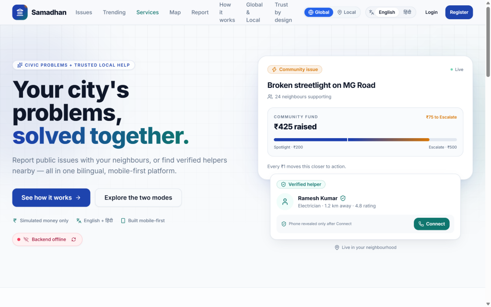
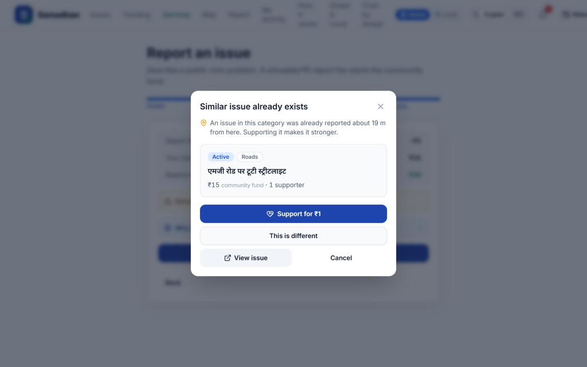
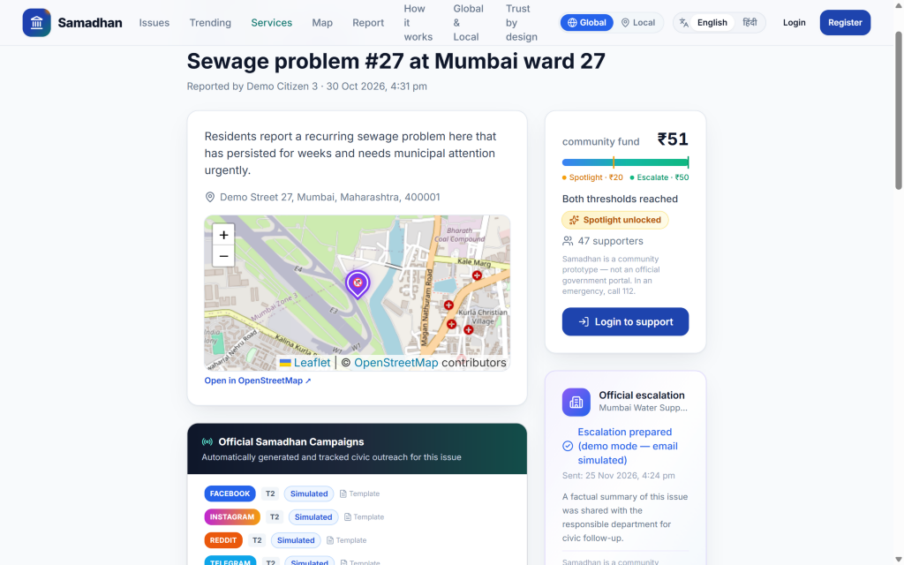
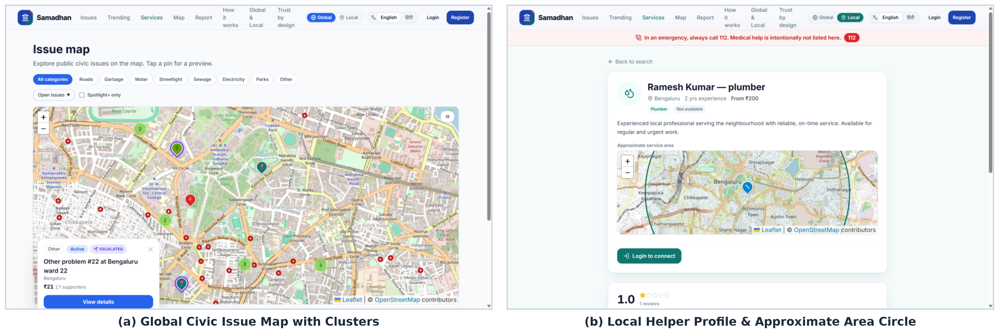
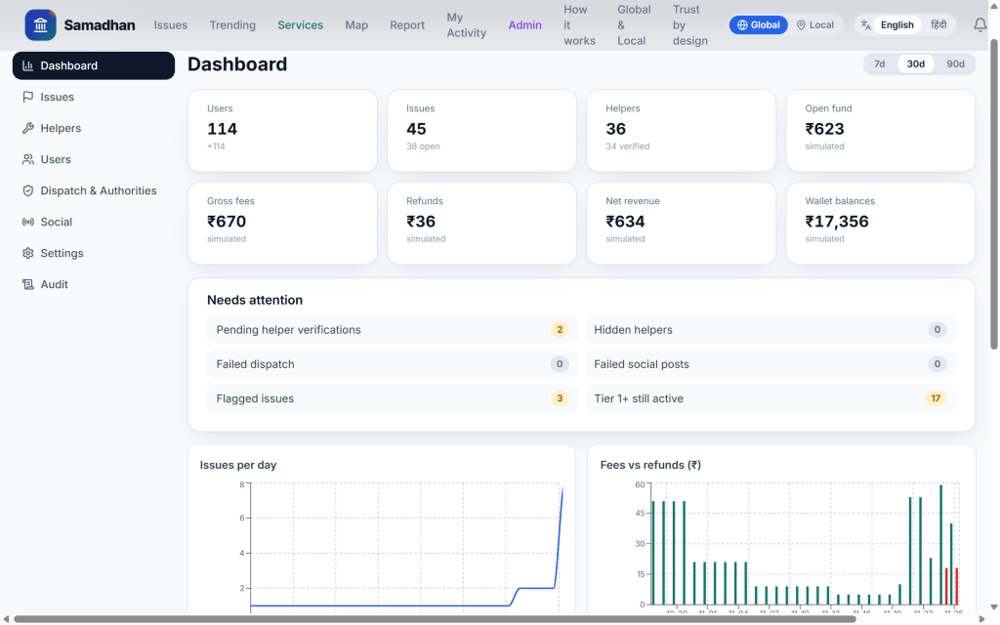

# CHAPTER 4

## EXPERIMENTAL RESULTS AND DISCUSSION

### 4.1 Walkthrough of Working Features

Users switch between English and Hindi from the top bar, and labels across the page update right away without losing form state. In Global Mode, the report wizard runs in four steps: details, map location, optional photos, and payment summary. Clicking on the map uses OpenStreetMap Nominatim with a 1.1-second delay between calls to fill address lines. When an active issue of the same category already sits within 100 meters, a duplicate prompt pauses submission and shows a 1-rupee support button next to an override option.

*Figure 4.1: Bilingual landing page showing the English/Hindi toggle and Global/Local mode switcher.*

*Figure 4.2: Four-step report wizard intercepted by the 100 m duplicate detection dialog.*

Once an issue gets reported or supported, the detail page updates its fund progress bar. Crossing Tier 1 (200 rupees normally, or 20 rupees in demo mode) unlocks six bilingual social post previews with a tracked share link (`/i/:id`). Anyone can download a 1080×1080 PNG share card rendered with Hindi font support. At Tier 2, the page displays the matched department name and dispatch status while keeping the office email hidden from public pages.

*Figure 4.3: Issue detail screen showing the fund meter, escalation card, and official campaign templates.*

Both civic issues and local helpers appear on Leaflet maps with marker clustering. Panning the civic map waits 500 ms before fetching up to 200 markers inside the current window. On a local helper's public profile, the map draws an approximate service circle around rounded 3-decimal coordinates. Admins log in to `/admin` to switch 7/30/90-day chart windows, inspect simulated email previews, add platform credits, reject spam, and browse audit diffs.

*Figure 4.4: Clustered Leaflet civic map and local helper approximate service area circle.*

*Figure 4.5: Admin dashboard showing KPI metrics, attention counters, and daily activity charts.*

### 4.2 Automated Tests and Code Checks

We ran Vitest unit tests, backend integration tests backed by `mongodb-memory-server` replica sets, and static project checks directly in the workspace terminal.

On the frontend, all 18 unit tests across 4 files (`geo`, `draftStorage`, `errors`, `format`) passed in 877 milliseconds. Our translation check (`i18n:audit`) verified 817 English keys, 817 Hindi keys, and 54 error codes with zero missing keys. It raised only 31 non-blocking warnings for shared brand labels. Accessibility linting (`eslint-plugin-jsx-a11y`) passed with zero errors. The `check:env` and `check:secrets` scripts also confirmed zero missing keys or leaks across all 42 server variables, 1 client variable, and 114 git-tracked files.

On the backend, 141 out of 142 tests across 10 Vitest suites passed in 32.25 seconds using real MongoDB transactions. Nine out of ten test files passed every single spec, including 20-way tier claim races, 15 parallel helper connect attempts capping at 10, exact rejection refunds, and corrupted data checks. One test in `notifications.test.js` (`tier winner fans out to reporter + supporters exactly once under 20 concurrent claims`) failed with `expected 0 to be 1`. Looking at `tier.service.js` and that test explained the failure. The test set Tier 1 to 600 paise, so the first supporter's 100-paise payment (`500 + 100 = 600`) claimed Tier 1 and fired alerts before the second supporter joined. Table 4.1 gives every suite's observed result and runtime.

*Table 4.1: Executed test suites and static quality checks with measured results.*

| Suite or Script | What It Checks | Cases | Measured Result |
| :--- | :--- | :---: | :--- |
| `client` `npm test` | `geo`, `draftStorage`, `errors`, `format` | 18 | **PASS** — 18/18 passed (877 ms) |
| `client` `i18n:audit` | EN/HI key parity and mapped error codes | 817 keys / 54 codes | **PASS** — 0 missing keys, 31 warnings |
| `client` `lint:a11y` | Accessibility rules across `client/src` | All JSX files | **PASS** — 0 lint errors |
| `client` `check-sw` | Built `dist/sw.js` precache rules | 43 cached files | **PASS** — 0 `/api` URLs cached |
| `server` `check:env` & `check:secrets` | `.env.example` match and secret pattern scan | 43 vars / 114 files | **PASS** — 0 missing vars, 0 leaks |
| `wallet.test.js` | Settings seed, idempotent top-ups, overdraft guard | 15 | **PASS** — 15/15 passed (1.49 s) |
| `issues.test.js` | Paid reports, feed filters, status transitions, refunds | 14 | **PASS** — 14/14 passed (1.79 s) |
| `support.test.js` | 100 m duplicate gate, concurrency, exact refunds | 24 | **PASS** — 24/24 passed (3.05 s) |
| `tiers.test.js` | 20-way tier claim race, email/webhook retry, cron | 25 | **PASS** — 25/25 passed (7.87 s) |
| `social.test.js` | Post templates, copy sanitization, OG page | 17 | **PASS** — 17/17 passed (2.01 s) |
| `helpers.test.js` | Dual radius search, 15-way connect cap, Unicode guard | 25 | **PASS** — 25/25 passed (2.42 s) |
| `notifications.test.js` | Map bbox, 3-decimal privacy, TTL, alert fan-out | 7 | **6/7 PASS** (1.95 s; 1 threshold-order fail) |
| `admin.test.js` | Role checks, platform credit, flags, user bans, audit | 10 | **PASS** — 10/10 passed (1.72 s) |
| `e2e.flow.test.js` & `verify-data.test.js` | Full API flow and 17-collection invariant verifier | 5 (1 + 4) | **PASS** — 5/5 passed (1.69 s + 0.87 s) |

### 4.3 Build Size and Test Timings

Running `npm run build` with Vite 6.4.6 compiled 2,823 modules in 6.89 seconds. Lazy-loading admin charts and Leaflet maps kept the landing page smaller. Still, the main JS bundle reached 664.37 kB (188.07 kB gzipped) because React, routing, and both language dictionaries load together. Workbox also generated `dist/sw.js` with 43 static shell assets totaling 1,455.54 KiB. Table 4.2 shows the measured build sizes.

*Table 4.2: Production frontend build chunk sizes measured from `vite build`.*

| Build Output File | Contents | Measured Size |
| :--- | :--- | :--- |
| Main JS (`dist/assets/index-*.js`) | React 18, router, Tailwind UI, English & Hindi translations | 664.37 kB raw (188.07 kB gzip) |
| Main CSS (`dist/assets/index-*.css`) | Base Tailwind styles and component theme tokens | 56.42 kB raw (10.12 kB gzip) |
| Lazy Charts (`AdminCharts-*.js`) | Recharts analytics loaded only inside `/admin` | 437.03 kB raw (117.02 kB gzip) |
| Lazy Maps (`MapShell-*.js` + CSS) | Leaflet core and marker clustering loaded on map views | 155.88 kB JS (45.88 kB gzip) + 15.33 kB CSS |
| PWA Shell (`dist/sw.js`) | Workbox offline shell cache (`0` API endpoints cached) | 43 files, 1,455.54 KiB total |

### 4.4 Bugs Found and Design Trade-offs

Several bugs popped up during testing and changed how we structured the code:

1. Slow email sends stalling database locks. Early drafts ran email dispatch inside the `supportIssue()` transaction. Slow SMTP timeouts (up to 10 seconds) kept MongoDB locks open too long and risked aborting payments [2]. We moved `checkTiers()` after commit and saved `DispatchLog` rows so payments finish first while failed sends stay visible for admin retries [5].
2. Retries hitting our own duplicate check. At first, `createIssue()` checked for nearby issues before checking `idempotencyKey`. If a user on a weak mobile signal created a report, timed out, and retried with the same key, the server treated their own brand-new post as a `409 DUPLICATE_FOUND` conflict. Checking idempotent replay first solved that bug.
3. Flipped latitude and longitude arrays. MongoDB `2dsphere` indexes expect `[longitude, latitude]`, while Leaflet expects `[latitude, longitude]`. Early map components mixed those up and dropped Indian pins in the ocean. We put coordinate conversion inside one shared `geo.js` helper to stop those errors. Rounding public helper coordinates to 3 decimal places also avoided slow privacy solvers [4, 6], though repeated lookups from different spots still show the same grid center.
4. Single-server prototype shortcuts. Rate limiters and daily connect locks sit inside Node server memory so local testing needs no Redis server. That works fine on one server instance but will not sync across multiple servers. Demo helpers also use dummy phone numbers (`isSample: true`) with WhatsApp links disabled so test clicks never contact real people.
