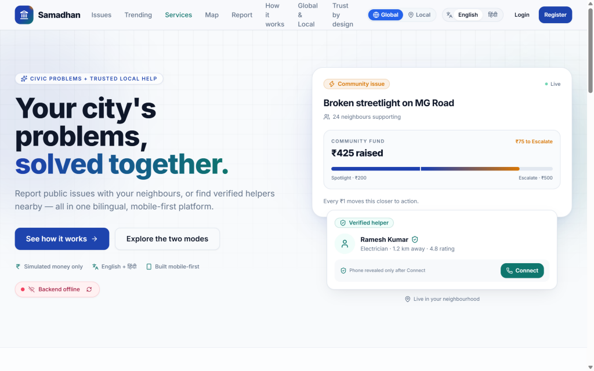
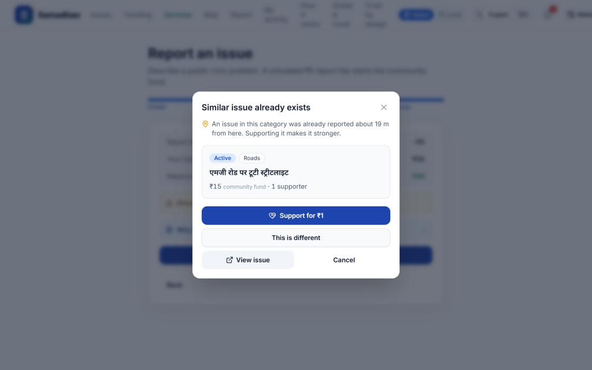
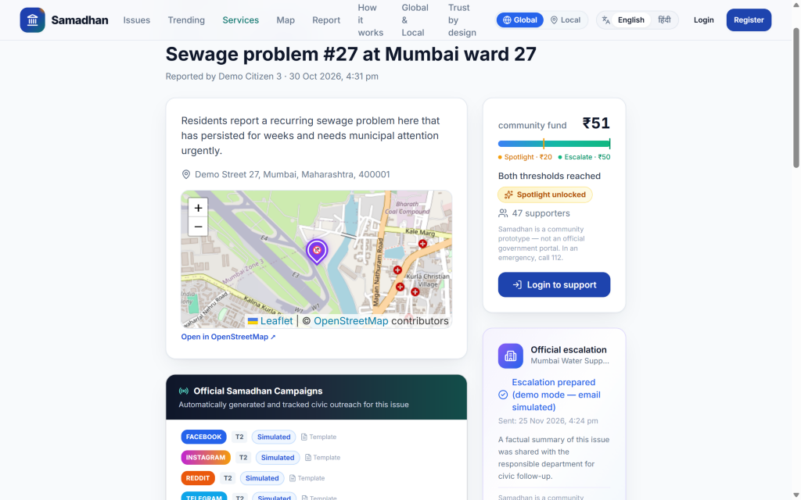
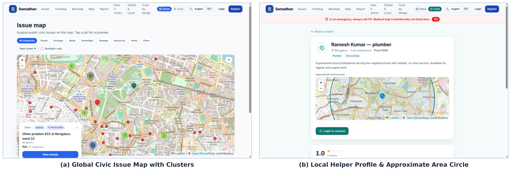
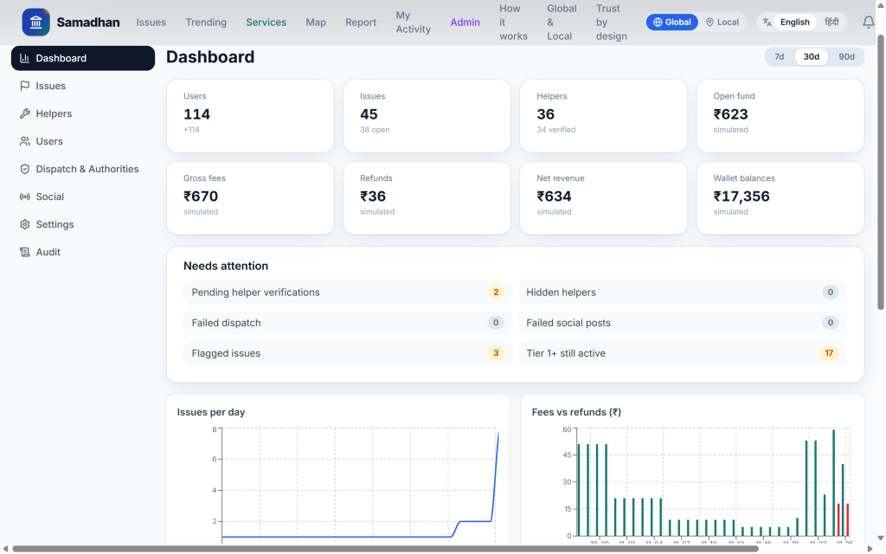

# CHAPTER 4

## EXPERIMENTAL RESULTS AND DISCUSSION

### 4.1 Live Browser Walkthrough and Screenshots

We booted the Express API on port 5000 and the Vite frontend on port 5173 against the seeded MongoDB Atlas database (`113` wallets, `45` issues, `36` helpers verified by `verify:data`). We then captured screenshots across five main screens. Figure 4.1 shows the bilingual landing page with the Global/Local switcher, the English/Hindi toggle, simulated-money notices, and preview cards.

*Figure 4.1: Bilingual landing page showing the English/Hindi toggle and Global/Local mode switcher.*

In Global Mode, logged-in citizens follow a four-step report wizard. As shown in Figure 4.2, placing a pin around 19 meters from an active Roads complaint triggered `409 DUPLICATE_FOUND` on submission. The "Similar issue already exists" dialog popped up with a 1-rupee support button without deducting the 5-rupee fee.

*Figure 4.2: Four-step report wizard intercepted by the 100 m duplicate detection dialog.*

Figure 4.3 shows an escalated Tier 2 issue (`Sewage problem #27 at Mumbai ward 27`, `₹51` raised from `47` supporters). The screen displays the full fund progress bar, the simulated Mumbai Water Supply dispatch notice, and the generated social post entries.

*Figure 4.3: Issue detail screen showing the fund meter, escalation card, and official campaign templates.*

Figure 4.4 places the clustered Bengaluru civic map side by side with a Local Mode helper profile (`Ramesh Kumar — plumber`). On the left, pins cluster into numbered groups with filter chips. A selected preview card sits in the bottom corner. On the right, the 112 emergency banner, `Login to connect` phone lock, and approximate area circle are all visible.

*Figure 4.4: Clustered Leaflet civic map and local helper approximate service area circle.*

Figure 4.5 shows the `/admin` dashboard with live database counts (`114` users, `45` issues, `36` helpers, `₹623` open fund, `₹670` gross fees, `₹36` refunds). Pending attention counters and daily Recharts activity plots sit right below the KPI cards.

*Figure 4.5: Admin dashboard showing KPI metrics, attention counters, and daily activity charts.*

### 4.2 Risk-to-Safeguard Mapping

Table 4.1 summarizes how common abuse and privacy risks are handled in the implemented codebase.

*Table 4.1: Risks and implemented safeguards in Samadhan v2.*

| Risk | Implemented Safeguard | Module / Mechanism |
| :--- | :--- | :--- |
| Spam complaints | Demo wallet report fee (`₹5`), category disable toggle, admin `REJECTED` flow with refunds | `wallet.service.js`, `issue.service.js` |
| Duplicate reports | 100 m / 30-day `$geoNear` lookup returning `409 DUPLICATE_FOUND` + `₹1` backing prompt | `issue.service.js` (`findDuplicate`) |
| Double billing / negative wallet | Unique `idempotencyKey`, conditional `balancePaise >= debit` inside transaction | `wallet.service.js` (`chargeWallet`) |
| Duplicate tier escalation | Post-commit atomic `findOneAndUpdate` filtering `tiersReached: { $ne: tier }` | `tier.service.js` (`checkTiers`) |
| Helper phone scraping / fake ratings | Phone omitted publicly, 3-decimal coords, 10/24h Connect cap, `Connection.exists` review gate, Unicode guard | `helper.service.js`, `contactGuard.util.js` |
| Unauthorized admin edits | Strict JWT + `ADMIN` guard, self-disable block, immutable PII-free `AuditLog` diffs | `role.middleware.js`, `audit.util.js` |

### 4.3 Automated Verification and Build Results

We ran the full verification scripts directly in the workspace terminal. On the client, all 18 Vitest unit tests passed in 877 milliseconds. Our `i18n:audit` check verified 817 English and 817 Hindi keys with zero missing items, while accessibility linting (`eslint`) passed with zero errors. The `check:env` and `check:secrets` scans confirmed 43 environment keys and 114 tracked files had no leaks.

On the server, 141 out of 142 integration tests across 10 Vitest suites passed in 32.25 seconds against `mongodb-memory-server` replica sets. Nine out of ten files passed every spec (`wallet` 15, `issues` 14, `support` 24, `tiers` 25, `social` 17, `helpers` 25, `admin` 10, `e2e.flow` 1, and `verify-data` 4). One test in `notifications.test.js` (`6/7` passing) failed with `expected 0 to be 1`. Its test setup lowered Tier 1 to `600` paise, so the first supporter's `₹1` payment (`500 + 100`) claimed Tier 1 and fired alerts before the second supporter joined. Tables 4.2 and 4.3 report all measured test and build outputs.

*Table 4.2: Automated test suites and static check results.*

| Suite / Check Script | Scope | Cases | Measured Outcome |
| :--- | :--- | :---: | :--- |
| `client` `npm test` | `geo`, `draftStorage`, `errors`, `format` | 18 | **PASS** — 18/18 passed (`877 ms`) |
| `client` `i18n:audit` | EN/HI parity & error code mapping | 817 keys / 54 codes | **PASS** — 0 missing keys (`31` warnings) |
| `client` `lint:a11y` & `check-sw` | JSX accessibility & SW cache exclusions | Full `src` / `43` assets | **PASS** — 0 lint errors, 0 `/api` cached |
| `server` `check:env` & `check:secrets` | `.env.example` & git secret scan | 43 vars / 114 files | **PASS** — 0 missing vars, 0 leaks |
| Server integration suites (9 passing files) | Wallet, issues, duplicate/support races, tiers, social, helpers, admin, E2E, verifier | 135 | **PASS** — 135/135 passed (`wallet` 1.49 s to `tiers` 7.87 s) |
| `notifications.test.js` | Map bbox, 3-decimal privacy, TTL, fan-out | 7 | **6/7 PASS** (`1.95 s`; 1 threshold-order fail) |

*Table 4.3: Production client build footprint measured via `vite build` (Vite 6.4.6, 2,823 modules in 6.89 s).*

| Build Output Artifact | Contents | Measured Size |
| :--- | :--- | :--- |
| Main JS (`dist/assets/index-*.js`) | React 18, router, Tailwind UI, EN & HI translations | `664.37 kB` raw (`188.07 kB` gzip) |
| Main CSS (`dist/assets/index-*.css`) | Tailwind CSS base & theme utilities | `56.42 kB` raw (`10.12 kB` gzip) |
| Lazy Charts (`AdminCharts-*.js`) | Recharts analytics loaded on `/admin` only | `437.03 kB` raw (`117.02 kB` gzip) |
| Lazy Maps (`MapShell-*.js` + CSS) | Leaflet core & marker clusters loaded on map pages | `155.88 kB` JS (`45.88 kB` gzip) + `15.33 kB` CSS |
| PWA Precache (`dist/sw.js`) | Workbox static shell (`0` `/api/` routes cached) | `43` files (`1,455.54 KiB` total) |

### 4.4 Bugs Fixed and Evaluation Limits

Testing revealed several real issues we resolved during development. Moving `checkTiers()` outside the payment transaction stopped slow SMTP timeouts from holding database locks open [2]. Replaying `idempotencyKey` before running duplicate checks fixed a mobile retry bug where weak connections blocked their own fresh report with `409 DUPLICATE_FOUND`. Putting coordinate order conversion (`[lng, lat]` vs `[lat, lng]`) inside `geo.js` fixed swapped map pins. On `/`, we also noticed a minor `HealthBadge` bug showing `Backend offline` when `/api/health` returns `200 OK`, which remains untouched as a known UI bug.

Because payments, emails, and social webhooks run in simulated mode without live credentials, real UPI settlement, SMS OTP verification, and multi-server load latency benchmarks remain outside this prototype evaluation.
